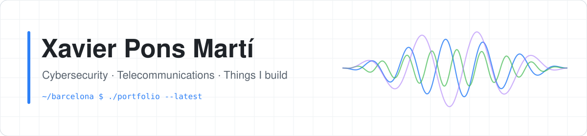
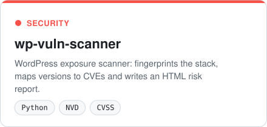
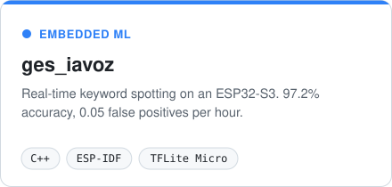
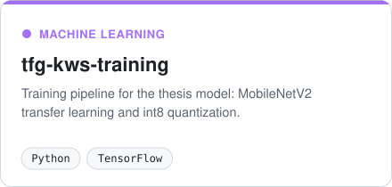
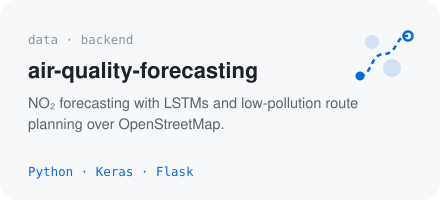
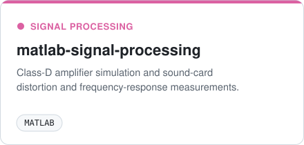
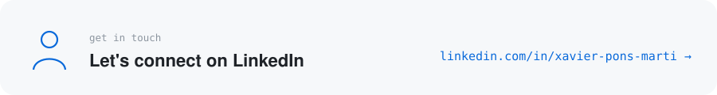

  <picture><source media="(prefers-color-scheme: dark)" srcset="assets/banner-dark.svg"></picture>

### Hi, I'm Xavi

Telecommunications engineer from Menorca. By day I work in cybersecurity as a consultant and SOC analyst at EY; the rest of the time I like building things: security tools, small ML models that run on microcontrollers, data projects and apps I actually use.

This profile is where I publish them. Some are polished, some are experiments — new things land here as I make them.

### Projects

<a href="https://github.com/XavierPonsM/wp-vuln-scanner"><picture><source media="(prefers-color-scheme: dark)" srcset="assets/card-wp-vuln-scanner-dark.svg"></picture></a>
<a href="https://github.com/XavierPonsM/ges_iavoz"><picture><source media="(prefers-color-scheme: dark)" srcset="assets/card-ges_iavoz-dark.svg"></picture></a>  
<a href="https://github.com/XavierPonsM/tfg-kws-training"><picture><source media="(prefers-color-scheme: dark)" srcset="assets/card-tfg-kws-training-dark.svg"></picture></a>
<a href="https://github.com/XavierPonsM/air-quality-forecasting"><picture><source media="(prefers-color-scheme: dark)" srcset="assets/card-air-quality-forecasting-dark.svg"></picture></a>  
<a href="https://github.com/XavierPonsM/mi-cartera"><picture><source media="(prefers-color-scheme: dark)" srcset="assets/card-mi-cartera-dark.svg"></picture></a>
<a href="https://github.com/XavierPonsM/matlab-signal-processing"><picture><source media="(prefers-color-scheme: dark)" srcset="assets/card-matlab-signal-processing-dark.svg"></picture></a>  

### Toolbox

       
        
     

### Background

- **MSc Telecommunication Engineering** · Universitat Oberta de Catalunya · *in progress*
- **BSc Telecommunications Engineering**, Audiovisual Systems · UPC – ETSETB · thesis on on-device AI, graded 9.5/10

### Get in touch

<a href="https://www.linkedin.com/in/xavier-pons-marti"><picture><source media="(prefers-color-scheme: dark)" srcset="assets/contact-dark.svg"></picture></a>

Always open to talk about security, embedded ML or a good side project.
